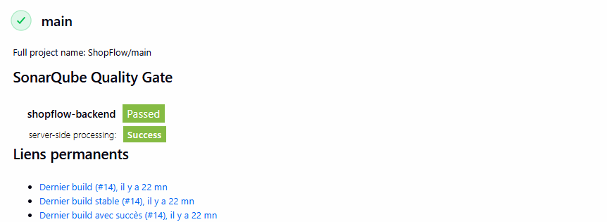
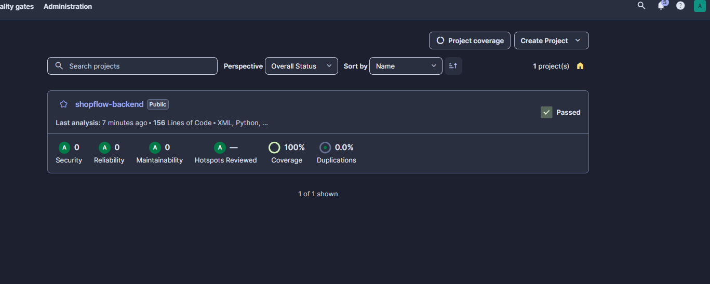

[](https://github.com/IlyasAnkri/shopflow-v1/actions/workflows/ci.yml)
# ShopFlow API 🛒

Une API RESTful conteneurisée pour la gestion de commandes, orchestrée avec Docker Compose.

## 🏗 Architecture

L'infrastructure repose sur 3 conteneurs communiquant via un réseau Docker isolé (`shopflow_net`) :

```text
[ Client HTTP / requêtes curl ]
              │
              ▼ (Port 80)
        ┌─────────────┐
        │    Nginx    │ Reverse proxy (redirige le trafic, gère les accès)
        └──────┬──────┘
               │
               ▼ (Port 8000)
        ┌─────────────┐
        │   FastAPI   │ Backend Python (logique métier, validation Pydantic)
        └──────┬──────┘
               │
               ▼ (Port 5432)
        ┌─────────────┐
        │ PostgreSQL  │ Base de données avec volume persistant (pgdata)
        └─────────────┘

🚀 Prérequis
Docker Desktop

GNU Make (make)

Python 3.x (pour l'environnement virtuel avec pytest et requests)

🛠 Comment lancer le projet
Un fichier Makefile automatise le déploiement et les tests. Exécutez ces commandes à la racine du projet :

Construire les images Docker :

Bash
make build
Démarrer l'infrastructure en arrière-plan :

Bash
make up
Exécuter les tests d'intégration (Pytest) :

Bash
make test
Arrêter et détruire l'infrastructure :

Bash
make down
📡 Liste des endpoints
1. Créer une nouvelle commande
Méthode : POST

Route : /api/orders

Corps de la requête (JSON) :

JSON
{
  "product": "Clavier Mécanique",
  "quantity": 2,
  "price": 150.0
}
Réponses :

200 OK : Retourne la commande créée avec son id unique.

422 Unprocessable Entity : Format de données invalide.

2. Récupérer l'historique des commandes
Méthode : GET

Route : /api/orders

Réponse :

200 OK : Retourne un tableau JSON contenant toutes les commandes enregistrées dans PostgreSQL.

🐛 Outils de diagnostic
En cas de panne, voici les commandes utiles pour inspecter les conteneurs :

Bash
# Vérifier l'état des conteneurs et des ports
docker compose ps

# Lire les logs de l'API en temps réel
docker compose logs -f api

# Lire les logs du reverse proxy
docker compose logs -f nginx

# Infrastructure CI/CD ShopFlow

Ce dépôt intègre une chaîne d'Intégration Continue (CI) automatisée définie dans le `Jenkinsfile` à la racine.

**Le pipeline exécute les tâches suivantes à chaque Push :**
1. Création de l'environnement et exécution des tests unitaires (`pytest`).
2. Analyse statique du code et de la couverture via **SonarQube**.
3. Validation par une **Quality Gate** (échec du pipeline si la couverture baisse).
4. Conteneurisation de l'API via **Docker**.
5. Livraison automatique de l'image finale sur **Docker Hub**.

**Résultat du Pipeline Jenkins :**


**Rapport d'analyse SonarQube :**
